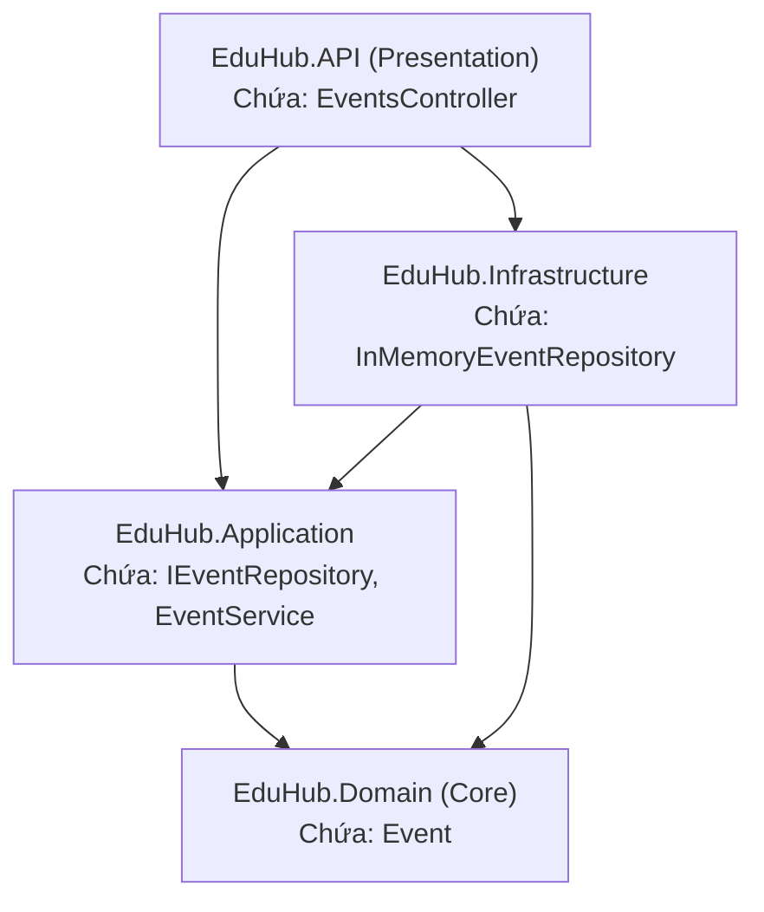
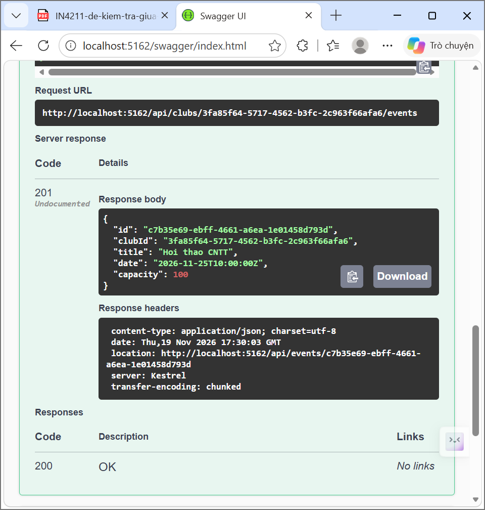
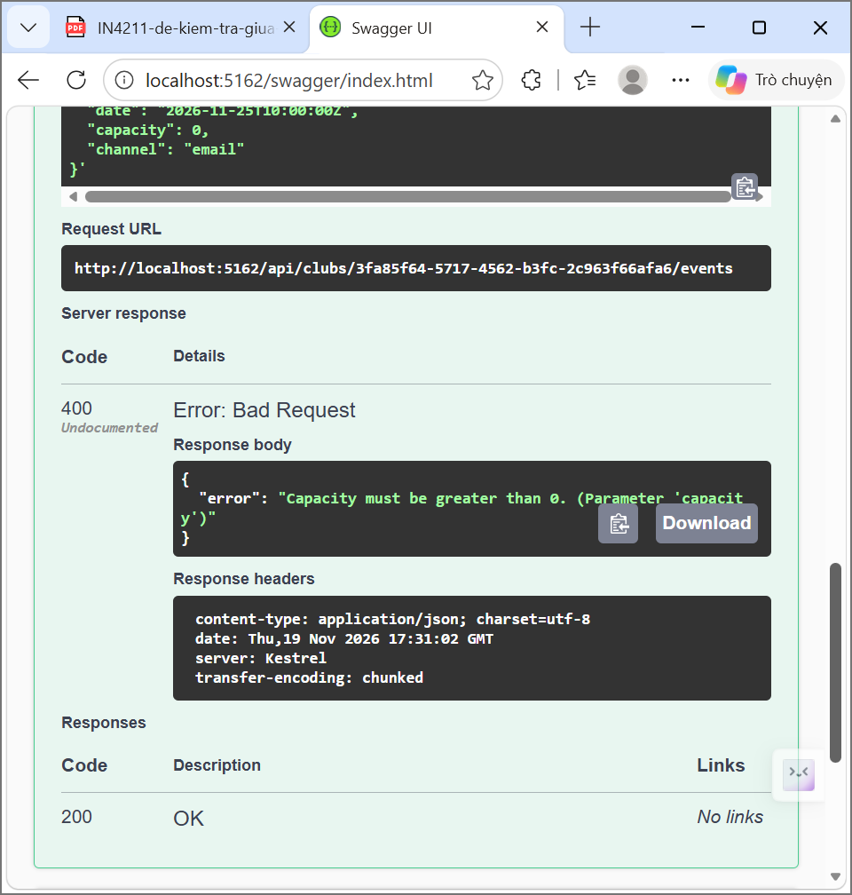

# BÀI LÀM LÝ THUYẾT ĐỀ SỐ 02

## Câu 1a
<!-- Nêu tên và giải thích ngắn gọn bốn trụ cột của lập trình hướng đối tượng. Với mỗi trụ cột, chỉ ra một chỗ trong code bài làm của em minh hoạ cho trụ cột đó (tên tệp và tên lớp) -->
1. **Tính đóng gói (Encapsulation):**
   - *Giải thích:* Che giấu dữ liệu nội bộ và các chi tiết cài đặt của đối tượng, chỉ cho phép truy cập và sửa đổi trạng thái thông qua các phương thức công khai hợp lệ.
   - *Minh hoạ trong code:* Lớp `Member` trong tệp `Member.cs` (Project `EduHub.Domain`) đóng gói các thuộc tính với `private set`, ẩn constructor mặc định và chỉ cho phép khởi tạo qua factory method `Create(...)`.
2. **Tính trừu tượng (Abstraction):**
   - *Giải thích:* Tập trung vào những đặc tính và hành vi cốt lõi của đối tượng cần thiết cho hệ thống, ẩn đi các chi tiết triển khai phức tạp bên dưới.
   - *Minh hoạ trong code:* Interface `IEventRepository` trong tệp `IEventRepository.cs` (Project `EduHub.Application`) định nghĩa các thao tác lưu trữ sự kiện mà không cần quan tâm dữ liệu được lưu trong bộ nhớ, SQL hay NoSQL.
3. **Tính kế thừa (Inheritance):**
   - *Giải thích:* Cho phép một lớp con tái sử dụng hoặc mở rộng các thuộc tính và phương thức từ một lớp cha (hoặc hiện thực hoá giao diện).
   - *Minh hoạ trong code:* Lớp `InMemoryEventRepository` kế thừa và hiện thực giao diện `IEventRepository` trong tệp `InMemoryEventRepository.cs` (Project `EduHub.Infrastructure`).
4. **Tính đa hình (Polymorphism):**
   - *Giải thích:* Khả năng các đối tượng khác nhau có thể phản hồi cùng một thông điệp (gọi cùng phương thức) theo những cách khác nhau tùy thuộc vào kiểu thực tế của đối tượng lúc thực thi.
   - *Minh hoạ trong code:* Cùng giao diện `INotificationService`, khi gọi phương thức `Send(...)`, `EmailNotificationService` và `SmsNotificationService` xử lý theo cách riêng (Project `EduHub.Infrastructure`).

## Câu 1b
<!-- Ghi hai vấn đề về tính đóng gói của lớp Member ban đầu vào đây -->
Có 2 vấn đề của lớp Meber chưa đóng gói:**
1 Thuộc tính Id, Email có setter public (dòng 3,4), nên bên ngoài gán m.Email = "abc" dòng 9 được mà khong bị kiểm tra, làm dữ liệu sai hợp lệ hóa
2 Constructor public khong làm tham số dòng 5 cho phép tạo member ở trạng thái không hợp lệ (Email == null, Id = Guid.Empty), bỏ qua luaatj nghiệp vụ 
Cách khắc phục: setter private, constructor private, và tạo đối tượng qua factory method Member.Create(email) có kiểm tra email khong rỗng và chứa "@"

## Câu 2a
<!-- Vẽ sơ đồ trạng thái của Registration bằng Mermaid (stateDiagram-v2), ghi rõ tên phương thức trên mỗi mũi tên chuyển trạng thái -->

```mermaid
stateDiagram-v2
    [*] --> Pending : Create() "phiếu mới tạo là Pending"
    Pending --> Confirmed : Confirm() "chờ xác nhận "
    Pending --> Cancelled : Cancel() "nếu Pending hủy được"
    Confirmed --> Cancelled : Cancel() "confirmed hủy được"
    Cancelled --> [*] " đã hủy thì không đổi nữa"
```

## Câu 3a
<!-- Chỉ ra ba nguyên lý SOLID mà lớp EventService vi phạm. Với mỗi nguyên lý, ghi số dòng vi phạm và giải thích ngắn -->
1. S - Single Responsibility Principle (SRP - Nguyên lý đơn trách nhiệm)
số dòng vi phạm: Dòng 6-14
giải thích: Lớp EventService ôm quá nhiều trách nhiệm: vừa kiểm tra dữ liệu nghiệp vụ, vừa trực tiếp kết nối cơ sở dữ liệu qua sqlConnection, vừa ghi file log hệ thống, vừa phụ trahs logic gửi gmail và SMS. Một lớp chỉ nen có một lý do duy nhất để thay đổi.
2. O - Open/Closed Principle (OCP - Nguyên lý Đóng/Mở):
số dòng vi phạm: dòng 11-14
giải thích: sử dụng if (channel == "email")... else if (channer == "SMS")... gắn cứng. khi hệ thống muốn mở rộng thêm kênh thông báo mới (như Zalo, Telegram, Push Notification), ta bắt buộc phải sửa trực tiếp mã nguồn của lớp EventService, vi phạm nguyên tắc "đóng với việc sửa đổi, mở với việc mở rộng".
3. D - Dependency Inversion Principle (DIP - Nguyên lý đảo ngược phụ thuộc):
Số dòng vi phạm: Dòng 8, 12, 14.
Giải thích: Lớp cấp cao (EventService) phụ thuộc trực tiếp vào các lớp cụ thể cấp thấp (SqlConnection, EmailSender, SmsSender) qua từ khoá new, thay vì phụ thuộc vào các Abstraction (interface).
## Câu 4b
<!-- Phân biệt git merge và git rebase. Khi nào không nên dùng rebase? -->
1. Phân biệt git merge và git rebase:

git merge:
Gộp các thay đổi từ nhánh khác vào nhánh hiện tại bằng cách tạo ra một commit gộp mới (merge commit) có hai commit cha.
Ưu điểm: Giữ nguyên vẹn 100% lịch sử thực tế và cấu trúc rẽ nhánh của dự án, an toàn cho làm việc nhóm.
Nhược điểm: Biểu đồ lịch sử (Git graph) có thể bị rối và nhiều nhánh chằng chịt nếu có nhiều người gộp code liên tục.

git rebase:
Lấy các commit của nhánh hiện tại và "nối tiếp" (chuyển gốc) vào đỉnh (tip) của nhánh đích.
Ưu điểm: Viết lại lịch sử commit thành một đường thẳng tắp (linear history), sạch đẹp, dễ theo dõi tiến trình phát triển.
Nhược điểm: Thay đổi mã băm (hash) của toàn bộ các commit được rebase, có nguy cơ làm mất ngữ cảnh thời gian thực tế.

2. Khi nào không nên dùng rebase?

Tuân theo "Quy tắc vàng của Rebase" (The Golden Rule of Rebase):
Tuyệt đối không dùng git rebase trên các nhánh công khai / chia sẻ chung (public/shared branches như main, master, develop) nơi có nhiều người đang cùng kéo code về làm việc.
Lý do: Rebase sẽ viết lại toàn bộ lịch sử commit (thay đổi commit hash). Nếu ai đó đã kéo nhánh này về trước đó, khi họ kéo lại sau rebase sẽ dẫn đến xung đột (conflict) nghiêm trọng và làm hỏng cây lịch sử Git của cả nhóm.
## Câu 5a
### Sơ đồ 4 lớp Clean Architecture và chiều phụ thuộc:


## Câu 5b
### Vì sao EduHub.Domain không được tham chiếu tới EduHub.Infrastructure:
- Theo Clean Architecture và nguyên lý Đảo ngược phụ thuộc (DIP), **Domain** là tầng trung tâm cốt lõi chứa các thực thể và quy tắc nghiệp vụ quan trọng nhất (Enterprise Business Rules). Tầng này phải hoàn toàn độc lập với công nghệ bên ngoài, cơ sở dữ liệu, hay framework kỹ thuật.
- Nếu `Domain` tham chiếu tới `Infrastructure`, nghiệp vụ sẽ bị phụ thuộc chặt (tight coupling) vào các công nghệ cụ thể của hạ tầng, làm mất tính độc lập, khó bảo trì, khó unit test và vi phạm chiều phụ thuộc hướng tâm của Clean Architecture. Chiều phụ thuộc luôn phải từ ngoài hướng vào trong: `Infrastructure` phụ thuộc vào `Domain`, không có chiều ngược lại.

## Câu 5c
### Minh chứng kiểm thử Swagger UI:
- **Ảnh gọi POST /api/events thành công (201 Created):**
  
- **Ảnh gọi POST /api/events thất bại với capacity <= 0 (400 Bad Request):**
  

## Câu 5d
### Giải thích lỗi AddScoped và cách khắc phục:
- **Nguyên nhân:** Dịch vụ đăng ký dạng `AddScoped` chỉ tồn tại trong vòng đời của một HTTP Request. Khi gọi `POST`, một instance mới của `InMemoryEventRepository` được tạo ra, lưu dữ liệu vào `List<Event>` của instance đó rồi bị huỷ ngay khi request kết thúc. Khi gửi tiếp `GET`, ASP.NET Core tạo một instance hoàn toàn mới với một danh sách rỗng mới.
- **Cách đăng ký để tránh lỗi:** Em đăng ký `InMemoryEventRepository` dưới dạng **Singleton** trong `Program.cs`:
  ```csharp
  builder.Services.AddSingleton<IEventRepository, InMemoryEventRepository>();
  ```
  Cách này đảm bảo duy nhất một instance repository được dùng chung cho tất cả các HTTP Request trong suốt vòng đời ứng dụng, giữ nguyên danh sách `_events`.

